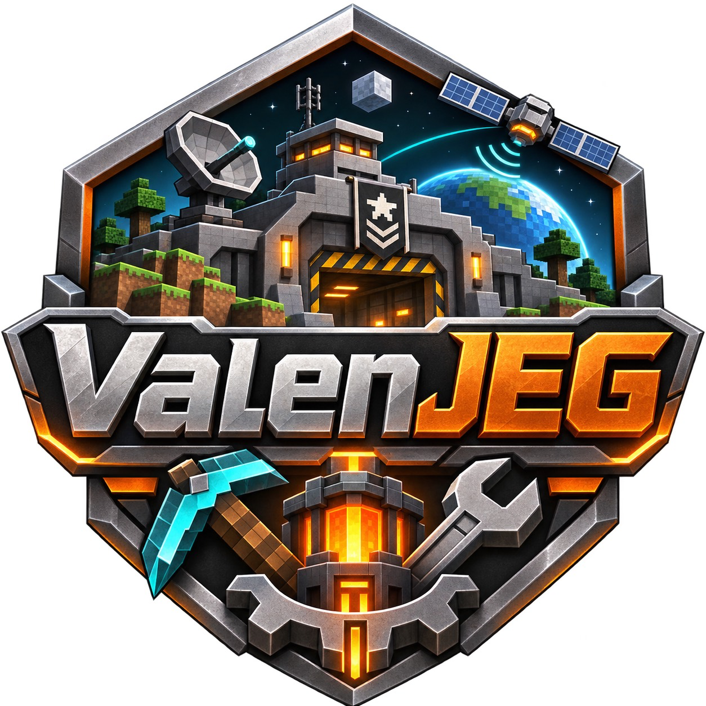

<p align="center"></p>

# ValenJEG — a ValenCraft mini-modpack

ValenCraft is a modular Minecraft modpack. ValenJEG is its weapons, military structures, technology and exploration mini-modpack: usable as a module in ValenCraft and developed toward standalone pack distribution.

This repository contains the pack definition **and its implementation code**. The root owns dependency selection, configuration and packaging. `components/` contains the gun fork, donor-mod ports, structure conversion tools and cross-mod compatibility code, with their original licenses and credits.

The current target is Minecraft **26.3**, **Fabric Loader 0.20.1**, and **Java 25**. This is a development snapshot. Several complete donor-mod ports still fail compilation; no finished 0.1.0 pack download is being claimed here.

## Contents

| Path | Purpose |
| --- | --- |
| `valencraft.module.json` | Mini-modpack identity and its place within ValenCraft |
| `mods.lock.json` | Real dependency versions, hashes, side selection and explicitly pending inputs |
| `overrides/config/` | Shared gameplay configuration |
| `components/` | Implementation source, resources, conversion and compatibility tooling |
| `scripts/pack.py` | Client/server assembly and Modrinth pack export |
| `branding/` | Owner-supplied ValenJEG logo |
| `docs/` | Build, component status and source provenance |

## Build the pack

```sh
python3 scripts/pack.py check --side client
python3 scripts/pack.py check --side server
python3 -m unittest discover -s tests -v
python3 scripts/pack.py assemble --side client --inputs /path/to/pinned-jars --output /path/to/new-instance
```

`check` validates the definition and lists pending inputs; it does not claim they are finished. Assembly stops before creating an instance when any required component is unresolved. Verified public downloads may be fetched with `--download`; custom builds must match the lock. Existing instance folders are never overwritten.

Supporting JAR filenames receive the `ValenJEG--` prefix during assembly. Their bytes, upstream signatures, internal mod IDs, versions and author metadata are preserved. Custom ports have their own ValenJEG display names. See [building](docs/BUILDING.md) and [component status](docs/COMPONENTS.md).

## Development scope

The core fork contains expanded firearms, magazine/attachment handling, restored stations and progression, and authored structure integration. Structure repair preserves donor layouts and restores actual mod blocks and models. HBM, Ad Astra, Scorched Guns and Combined Arms/Superb Warfare are included as source ports in progress. The dependency lock makes unfinished inputs explicit.

Source presence, compilation, native gameplay qualification, installation and player acceptance are separate milestones. See component status for the current evidence. Public source population does not install or alter an existing world.

## Licenses and credits

The pack definition retains the owner's [MIT license](LICENSE). That license does not replace component licenses. JEG's inherited GPL license, HBM's LGPL notices, the Terrarium License for Ad Astra, and other upstream notices remain with their components. Reserved upstream artwork is referenced through pinned source manifests rather than relicensed. See [third-party notices](THIRD_PARTY_NOTICES.md).

Developed by **Valen Systems** as part of **ValenCraft**. Original creators retain their respective rights and attribution.

For release delivery, see the [CurseForge upload file guide](docs/CURSEFORGE-UPLOAD.md).
